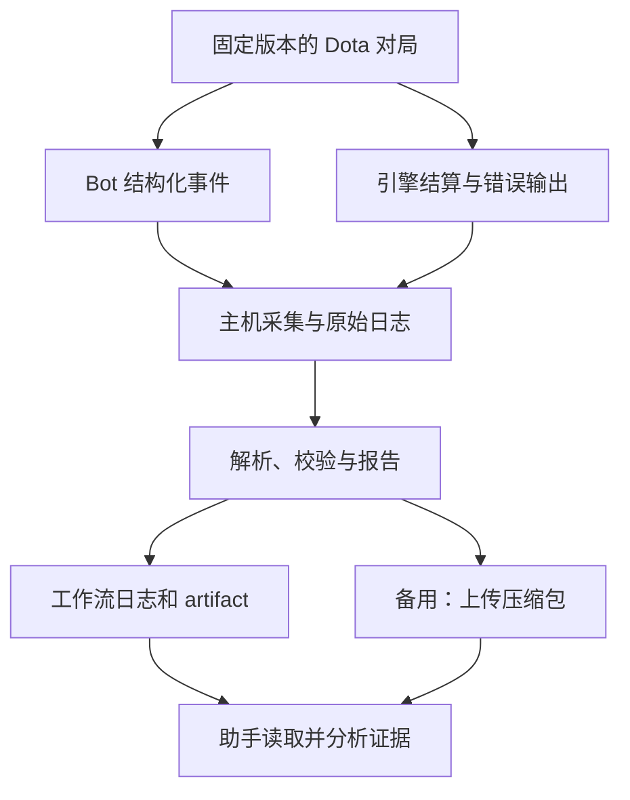

# OHA-Next：对局采集、数据协议与助手读取

> 状态：**deferred / 长期设计**。2026-11-19 用户决定先做玩法需求；当前不开发故障监控、批量对局及自动回传。以下是保留的未来架构，不是当前实施计划。
>
> 更新日期：2026-11-19（北京时间）
>
> 架构：[OHA_NEXT_ARCHITECTURE.md](OHA_NEXT_ARCHITECTURE.md)
>
> 验收：[OHA_NEXT_REQUIREMENTS.md](OHA_NEXT_REQUIREMENTS.md)

**本轮实施边界：** 不配置测试主机、不加 Bot 埋点、不部署 watchdog、不运行或自动上传实战数据。本文件仅供未来恢复验证基础设施时参考；当前功能改动按 [OHA_NEXT_REQUIREMENTS.md](OHA_NEXT_REQUIREMENTS.md) 中 F 类需求推进。

## 1. 对局结束后，数据如何到达助手

助手不会自然看到用户电脑里的游戏文件，也不会因 Dota 结束而自动收到通知。需要建立一条明确的传递链：游戏输出 → 主机采集与校验 → 数据包上传 → 助手在会话中通过已授权的渠道读取。



推荐主通道为受控 GitHub Actions 工作流：游戏主机完成采集，上传 artifact，并把小型摘要写入 job 日志与工作流摘要。助手先读取指定 run 的状态与日志，再按需下载完整 artifact。已连接的 GitHub 接口支持列出 artifact、下载 artifact ZIP 和读取 job 日志；**真实对局经过此通道读回的端到端流程仍待验证**。

若尚未接通上传，命令行工具生成同样格式的压缩包，由用户附到会话；助手据此分析。这个备用方式不要求用户手动打比赛。后台持续运行、定时触发及自动通知是后续能力，本轮没有创建这些任务。

## 2. 组件职责

| 组件 | 负责什么 | 边界 |
| --- | --- | --- |
| 运行清单生成器 | 生成唯一运行编号、固定源码与构建、配置测试场景 | 不依赖浮动分支名；记录实际解析出的完整 SHA |
| Bot 内观测模块 | boot、状态、决策原因、命令与观察事件 | 不上传网络、不持有 GitHub / Steam 凭据、不改变策略状态 |
| 主机 runner / collector | 启动、超时与取消、保存 stdout / stderr 和已验证的控制台文件 | 每局隔离目录与日志；确认游戏实际加载目标脚本 |
| parser / validator | 提取结构化事件及引擎结算、检测缺失与冲突 | 不通过猜测填补未知值；原始证据可回查 |
| analyzer / reporter | 计算有定义、有覆盖率的指标，生成单局和批次报告 | 命令与执行结果分开；不把相关性直接当因果 |
| publisher | 上传清洗后的数据包和摘要，记录读取位置 | 上传失败独立报告，重传不重新开局 |
| 助手 | 读取指定证据，复核失败、归因并提出或实施后续小 PR | 不凭空知道本机数据；只有当前授权来源可读 |

## 3. 数据来源及证据强度

| 数据 | 来源设计 | 如何使用 |
| --- | --- | --- |
| 源码 / 构建 / 配置身份 | 主机 manifest + 游戏内 boot 交叉核对 | checkout 成功不足以证明实际加载；必须与预期 bot 对应 |
| 模式、目标、意图与拒绝原因 | OHA-Next 主动埋点 | 原生战绩不能还原代码为什么这样选；未埋点原因是 unknown |
| 下达的移动、攻击、技能或物品命令 | 协调 / 执行入口埋点 | 表示 submitted，不直接算命中或成功施法 |
| 冷却、资源变化、动作状态与效果 | 当前 Bot API 可观测状态或已校准事件 | 仅在证据足够时记录 observed；关联与因果限制注明 |
| 位置、血量、蓝量、等级、经济 | 自身可用 API 的限频快照 | 逐项能力探测；钱包金币不等于净资产 |
| 胜负、时长、KDA、补刀、GPM / XPM 等 | 已校准的引擎结算适配器；API 观测作补充 | 字段有来源与支持状态，不能保证每种启动模式都输出全部项目 |
| 错误、进程退出、卡死或采集丢失 | 原始日志、主机看门狗、事件序号与心跳 | 区分游戏失败、数据失败和评估退化 |
| 录像或世界状态导出 | 经当前游戏版本验证后作为可选附件 | 首期不是硬依赖；分析真值与 bot 当时视野严格分开 |

Bot Scripting 环境与 Workshop 自定义游戏服务器环境并不应被当作同一个 API 集合。实施时根据所选客户端做 capability probe，记录接口是否可用、字段是否能读到。仓库 [BOT_API_REFERENCE.md](BOT_API_REFERENCE.md) 是接入参考，不替代实机校准。

本地 / 离线 / 自建对局使用项目自己的 `match_id`；只有实际取得官方编号时才填写 `official_match_id`。首期不依赖 OpenDota、公开历史记录或官方 Match ID 存在。

## 4. 单局数据包契约

所有名称为拟实现格式。`run_id` 标识批次，`match_id` 标识批次内独立一局，`attempt_id` 区分重试；重试不能覆盖失败证据。每个文件和压缩包限制大小，原始数据不提交到源码分支。

| 文件 | 内容 |
| --- | --- |
| `manifest.json` | schema、批次 / 对局 / 尝试 ID，来源仓库、双方源码 SHA、构建摘要、配置摘要、collector / parser / analyzer 版本 |
| `boot.json` | 从实际日志提取的 bot / team / build 身份与能力探测；与 manifest 预期比较 |
| `raw/` | 去敏后归档的原始 stdout、stderr、控制台及必要诊断日志；记录去敏规则和截断情况 |
| `events.jsonl` | 标准化事件，每行一个 JSON 对象，关联原始日志文件和行号 |
| `result.json` | 执行状态、胜负 / 时长及其来源、参与者摘要；不支持项为 null |
| `players.csv` | 可取得的逐英雄统计，空值与字段支持表配套；不补造 0 |
| `validation.json` | schema、版本、身份、事件完整性、结果冲突及各评测配置的有效性 |
| `summary.json` | 小型机器可读摘要，含总尝试、有效 / 无效数、覆盖率与主要结果 |
| `report.md` | 可读结论、限制、异常时间段、主要统计及原始证据索引 |
| `checksums.sha256` | 对最终归档文件计算摘要；不含自身 |
| `replay/`（可选） | 若成功保存录像，附文件及其版本、生成方式 |

manifest 还需记录：游戏构建号、模式、双方英雄 / 阵营映射、难度、额外金币 / 经验 / 属性开关、视野设置、时间倍率、采样配置、OS、主机资源概况、墙钟起止时间及限制。时间戳存带时区的 ISO 8601，展示给用户时可转北京时间；游戏时间单独记录，允许赛前负值，不与墙钟混用。

引擎参数分别记录 requested、effective（未知则为 null）及核对证据。脚本 boot 的配置摘要只能证明脚本收到的配置，不能证明模式、难度、时间倍率等引擎设置已生效。游戏构建及某项对照依赖的关键设置未确认时，禁止据此作相应强度比较。

随机性字段至少区分 `requested_seed`、`seed_control_supported` 和实际生效证据。没有验证可控时填 false / unknown，不承诺固定 seed 可复现全部引擎随机行为。

### 4.1 启动身份与构建哈希

启动前冻结源码 SHA 与所有有效配置。构建包摘要采用明确的文件范围；如果 boot 中嵌入构建摘要，计算时排除该生成身份文件并在 manifest 记录排除规则，避免循环哈希。部署后再核对包内容。

每个预期运行自定义脚本的 bot 应报告自身 ID、team、build ID、配置摘要和 schema。清单、部署内容与实际 boot 三者交叉核对；不以任意一条启动日志冒充全部 bot 正确加载。旧版本未提供埋点时，需要单独构建经过 A/A 检查的观测适配版本，并记录其真实构建身份。

### 4.2 事件协议 v0

游戏端建议输出单行 `[OHA_NEXT] ` 前缀加 JSON；字符串转义、有限数值、行长限制与序列化失败必须有明确处理。先验证控制台通道是否完整。游戏端不假定可以任意写文件或使用完整网络 API。

规范化事件至少包含：`schema_version`、`run_id`、`match_id`、`attempt_id`、`stream_id`、`seq`、`game_time`、`actor_id`、`team`、`event`、`payload`。`stream_id` 标识一个已确认的事件流，`seq` 在流内单调；不能用不同 bot 的行到达顺序当全局因果顺序。缺口、重复和重启需显式记录。

心跳超时规则必须区分死亡 / 重生、暂停和相关模式不被回调等预期静默。结合外部进程状态与已验证的生命周期判断卡死，不能仅凭某个 bot 暂无日志就报游戏故障。

建议事件族：

| 事件 | 内容 |
| --- | --- |
| `boot`, `heartbeat` | 版本与能力、存活信息、丢弃计数 |
| `snapshot` | 已验证可用的自身状态和可见环境摘要 |
| `mode_changed`, `target_changed` | 前后值、发生时间与触发原因 |
| `intent_selected`, `intent_rejected` | 关联意图、理由码及必要判断输入 |
| `action_submitted`, `action_observed` | 命令与后续观察分别记录，并通过 intent ID 关联 |
| `intent_expired`, `action_interrupted` | 到期、取消、打断的来源与原因 |
| `error`, `degraded`, `telemetry_dropped` | 故障、降级、采样溢出，不能静默隐藏 |

建议初始状态采样为约 1 次 / 秒，行为变化按事件记录；这是待校准默认，不保证适合所有英雄。重要场景可短时增加采样，完整运行需报告采样间隔及覆盖。该协议只能让有埋点的行为可解释，不能补出未记录的内部思考。

### 4.3 全员行为采样：包括在玩家战争迷雾中的 Bot

**这里的目标是检测“Bot 因 Bug 失去正常行动能力”，而非主观挂机。** 仅靠胜负、KDA、经济或错误栈，无法发现某个 Bot 在战争迷雾中因为脚本异常、条件死循环或动作失效而长期不动。每个自定义 Bot 在正常运行时主动报告自己的位置和行为；但这一条通道不够，因为 Bug 本身可能让自报停止。完整检测必须另外验证独立于被测 Bot 脚本的游戏实体观察方式，详见 4.6。

- 每个预期运行脚本的英雄有独立 `actor_id`、`team`、`stream_id`、boot、heartbeat 和游戏时间。以该 bot 自己的 `GetLocation()` 等 API 报告 `x,y`，而不是从敌方可见列表查找它；对敌方玩家是迷雾，对该 bot 自身不是未知位置。
- 限频 snapshot 建议先从**每 2 秒一个**起步（待性能校准），包含位置、HP/MP、alive、is_disabled、is_channeling、current_action、mode、target/goal、last_proposed_intent、last_submitted_action、观测到的结果及字段支持情况；目标/模式/命令变化另发事件。
- 采集器应为每个 bot 聚合覆盖率、心跳缺口、轨迹与行动进度；还需外部记录游戏进程状态。若没有拿到某个 bot 的 boot，不得默认它运行正常或被正常观察。
- 自身日志只记录当前 bot 在正常游戏中合法知道的信息。**测试分析端**可以汇总两队各自的自报状态，但**游戏策略不能接收分析端跨队全图信息**，保证强度测试不靠战争迷雾作弊。
- 特殊情况：脚本加载失败、崩溃、回调不执行或日志丢失时，该 bot 可能无法继续上报位置。只能报告最后已知坐标和 `missing_heartbeat`，必要时通过经过验证的独立引擎观测通道补充，不能编造它现在的位置。

### 4.4 自动异常检测器（独立于 Bot 决策）

监测器运行在游戏外测试主机上，在收集事件的同时维护滚动窗口；**不必等游戏结束**才发现可疑情况。阈值仅是首期候选，需用真实正常对局和注入案例校准，不能仅凭单项阈值自动认定 Bug。

| 疑似异常 | 组合信号与理由 | 需要排除/降权的合理情况 |
| --- | --- | --- |
| `suspected_idle` | 存活且应可行动；连续一段时间位置轨迹很短、没有有意义的攻击/施法/交互/目标进展 | 泉水购物、埋伏守点、等待队友、暂停、赛前、频道施法、受控状态 |
| `path_stuck` | 持续要求移动，却几乎没靠近目的地，或重复规划同一路径却没有进展 | 合法绕路、地形变化、强制位移或时间很短的避险动作 |
| `mode_thrashing` / `target_thrashing` | 模式/目标来回切换次数异常，且进度/输出很少 | 连续发生多个合理威胁、团战快速转火；必须保留原因 |
| `missing_heartbeat` | 已预期运行的 bot 有效心跳缺失，同时检查进程、采集流与暂停状态 | 日志积压、Bot 回调被暂停、游戏结束、某英雄进入特殊控制状态 |
| `team_response_gap` | 某 Bot 长时间缺席关键团队目标，且没有已记录的合理计划 | 分推、换线、保核心发育、战略放弃；只作为待分析战术信号 |

对于 `suspected_idle`，监测器不能只算首尾位移：在很小范围内来回走（`net_displacement` 小但 `path_length` 大）可能是模式抖动，而不是完全不动。还应检查过去是否发出了有效指令，目标是否持续有效，Bot 是否处于不能行动的状态。没有目标原因时输出 `inconclusive`。

例如下面是**期望生成的异常摘要示意，不是任何已发生对局记录**：

```json
{
  "event": "anomaly_detected",
  "type": "suspected_idle",
  "run_id": "example-run",
  "match_id": "example-match",
  "bot": {"actor_id": 7, "team": "dire", "hero": "npc_dota_hero_lion"},
  "game_time_start": 1500.0,
  "game_time_end": 1540.0,
  "last_known_position": {"x": -3200, "y": 4100},
  "signals": {"alive": true, "can_act": true, "path_length": 18, "last_observed_action": null},
  "classification": "needs_review",
  "reason_codes": ["little_movement", "no_observed_progress"],
  "evidence": {"before_sec": 60, "after_sec": 20, "stream_id": "bot-7", "log_index": "raw/console.log"}
}
```

这里的坐标应来自实际采样，不是对战玩家是否看见该英雄。想定位地图上的位置，可以按已校准的游戏地图坐标系制作轨迹图、热区图，标出 `last_known_position`、异常起止位置与目标点；不需要人工满地图找。地图尺寸与坐标系须用测试版本校准。

### 4.5 异常现场与可量化覆盖

- 每次告警保存相关 bot **告警前 30–60 秒、告警后 15–30 秒**事件窗口（均为待测建议值）、原始日志行号、最后有效目标、意图选择/拒绝原因、最后成功观察的行动、模式切换序列。默认从采集器缓冲区导出，不要求有限制的 Lua VM 保存大量轨迹。
- 每局报告计划监测的 bot 数、boot 匹配数、实际有样本数、每个 bot 的采样覆盖率、心跳缺口时长、告警次数、异常占游戏时间比例及未知区间。**零告警而没有采样，不等于零异常。**
- 实现前先准备可确定的诊断 fixtures：活着但故意不移动、重复下达无效移动、短时正常蹲守、死亡/眩晕、暂停、丢失心跳、日志缺口、合法防守和模式抖动。执行这些 fixtures 必须能识别或合理排除，并输出解释。
- 用持续检测发现频繁 Bug，用刻意构造的场景提高低频问题触发率；之后跑更多局验证稀有情况与稳定性。不要在缺乏全员覆盖时仅凭增加到 100 局来宣称质量提升。
- 若实时流不可用，可以先把全员状态记录到本机控制台，赛后解析并定位；检测时效属于待实现能力。但即使采用赛后检查，也必须保留全员轨迹、覆盖率和异常时间段，而不是只有局末战绩。
- 异常报告是诊断线索。是否真的不合理需要结合上下文与复现；防止将策略正确的埋伏直接算作挂机率。

### 4.6 故障型停滞的独立监测（高优先级）

不能只依赖有问题的 Bot 自己给我们发“我卡住了”。设想 A 英雄位于玩家战争迷雾中：如果错误导致 Think 回调停止、脚本加载出错或 Lua 模块抛错，该 Bot 的 `heartbeat`、`snapshot`、位置及原因日志可能**一起停止**。游戏进程仍在跑、另外九个 Bot 正常、战绩尚未结算，都不能证明 A 正常。

建议建立与被测 Bot 的 Lua 执行路径独立的 **engine observer / test harness**。它属于测试设施，只读取游戏实体的坐标、存活和运动等状态，不向实战 Bot 提供额外战争迷雾信息。可能的适配途径需验证 Dota 当前版本支持的世界状态流、服务器观察者/回放或其他可授权的引擎侧接口；**当前没有验证哪一种在 OHA-Next 的运行模式下可用**。

| 场景 | 自报日志 | 外部引擎观察 | 检测结论 |
| --- | --- | --- | --- |
| Bot 因条件分支卡住，不发有效命令 | 心跳在，但目标/命令无有效进展 | 仍在原位置，存活可行动 | 可报警 `bug_induced_stall_suspected` 并抓决策上下文 |
| Bot 持续向不可达目标发移动命令 | 命令在，但位置/距离无进展 | 轨迹/目的地证实无进展 | 可报警 `path_or_action_stuck` |
| Lua 异常或回调停止，自报中断 | 心跳消失、最近有错误或未终止日志 | 实体仍在相同地点、存活可行动 | 可报警 `script_unresponsive_entity_static`，保留错误上下文 |
| 只是控制台日志丢了 | 自报突然消失 | 外部采样显示实体继续活动 | `telemetry_failure`，不误判为 Bot 卡住 |
| 原地等待有战术理由 | 自报有明确等待目标与截止时间 | 坐标不变 | `intentional_hold`；必要时抽样检查其合理性 |
| 独立引擎观测不可用 | 自报也消失 | 缺失 | **`unobservable`**：仅知最后上报时的坐标，不能凭想象给出实时位置 |

对检测系统的要求：

1. 第一优先级是确定**出现了故障症状**及其位置、时间和影响范围；“为什么发生”需要关联最近的状态/指令/错误栈、代码审查和复现场景。没有因果证据时根因填 `unknown`。
2. 外部 observer 必须与受测策略逻辑隔离，并和 Bot 自报/引擎日志按游戏时间对齐（允许独立流时钟偏差）。即使它使用完整地图真值，也不能反向参与选目标、技能释放或团队决策。
3. 如果独立 observer 因工具限制不能读取所有单位，需在 `capabilities`、`validation.json` 和逐 Bot 报告中列出盲区。未覆盖的英雄不得被算作“没有停滞”；大规模比赛也不能以“全部无告警”证明代码没有此类故障。
4. 故障注入测试需主动令某个 Bot 停止发命令、停止 Lua 回调/心跳、持续发送不能完成的移动命令，并分别制造正常蹲守与死亡/控制状态。系统应证明可以**独立定位前两类 Bug**（前提是外部接口可用），并对合理情况降低误报；未能通过则阻止对应“全图 Bug 检测”能力验收。
5. 用位置/轨迹标出异常区间及最后稳定目标：若 observer 有效，报告当时引擎位置；若没有，报告 `last_known_position`、采样时刻和置信等级，避免混淆。

这类监督只用于对局测试；运行中发现异常时可保存现场、日志索引和后续窗口。首期也允许赛后解析已持续采集的轨迹，不要求能实时通知用户，但不允许只保留赛后战绩。

## 5. 状态模型与坏数据处理

避免单一 `success` 混淆“进程退出”“数据齐全”和“改进有效”。分别记录：

| 轴 | 值 | 含义 |
| --- | --- | --- |
| `execution_status` | completed / timed_out / crashed / cancelled / launch_failed | 对局是否明确完成；进程退出码为 0 不足以证明 completed |
| `data_status` | valid / partial / invalid | 按本次预先选择的评估配置，数据是否满足必需字段与身份要求 |
| `evaluation_status` | pass / regression / inconclusive / not_evaluated | 对明确测试判据的结论；pass 不自动表示总体更强 |
| `upload_status` | pending / uploaded / failed | 证据是否已发布到可读位置，与对局状态分离 |

不同评估配置的最小字段不同：稳定性检查需要启动、生命周期与错误证据；胜负评估必须有可信终局；目标锁定评估还需要目标 / 意图时间线。可选录像或不支持的净资产字段缺失，不应让所有评估一概无效；但依赖这些字段的指标不得计算。

规则：

1. 缺 boot、源码 / 配置不符、双方版本无法确认：对应实验无效，不统计为目标版本战绩。
1a. 在 Bug 停滞评测中缺失某个预期 bot 的 heartbeat 或连续轨迹时，先检查独立引擎观察；没有可用的独立实体采样则该区间标为 `unobservable`，不能把它视作“无故障”。匹配结果/胜负评测与停滞故障评测分别评估数据有效性。
2. 超时、异常退出、无终局证据：不凭领先经济推断胜负；保留为未完成 / 不确定。
3. 胜负枚举只接受已校准的合法值；未知值不能一律映射为另一阵营。多来源冲突必须报告。
4. 样本缺失用 null / unknown，计算分母是实际有效观测数；不能把钱包金币当净资产，不能把缺失 GPM 当 0。
5. 重复 / 乱序 / 截断按流和证据定位；无法恢复时，依赖该时间线的结论降为不确定。
6. 全部计划和尝试进入批次总数，失败不静默剔除；分别报告启动成功率、有效完赛数、坏数据比例与胜率分母。
7. 上传失败可用保留的不可变数据包重试；严重采集错误或游戏崩溃时仍尽力保存并上传诊断包，工作流保留失败状态。

## 6. 首跑与 A/B 校准

### 6.1 首场闭环

先单进程、正常倍率，使用独立测试目录和明确的游戏安装位置。按顺序验证：能启动 → 加载目标构建 → **所有预期 bot 的 boot 和位置/行为心跳均匹配** → 能定位对方玩家迷雾中的本方自报 Bot 位置 → 故障场景中 watchdog 能给出对应坐标和上下文 → 对局状态可判定 → 原始日志和数据包完整 → 上传 → 助手实际读回。

M2 完成必须包含至少 1 局身份匹配、可信完赛且胜负 / 时长和必需数据有效的真实对局，由助手读回其证据。一次超时或失败后的诊断包只能证明异常收集 / 读取通路，不足以宣称完整对局闭环已通过。

标准输出、控制台文件路径和 headless 参数取决于验证过的游戏环境，不能直接把其他 Fork 的命令视为已经可用。多局并行前必须隔离运行目录、端口、日志及临时配置；不得让多进程争用一份 `console.log` 或轮流覆盖同一脚本目录。

第一场可发现环境问题；随后以小规模 A/A 检查采集和侧别偏差，再逐步扩大。稳定性结论与强度结论分别报告。

### 6.2 比较候选与基线

- 同场 A/B 需要双方分别加载正确版本，验证 `require` 路径、模块缓存、全局状态和配置隔离。只打印两句不同标签不足以证明隔离正确。
- 候选和基线交换天辉 / 夜魇，匹配阵容和条件；也可采用已验证隔离的固定对手设计。
- 若暂不能隔离版本，只能报告同版本自博弈稳定性和场景行为。旧版自博弈与新版自博弈的天辉胜率变化不能证明候选更强。
- 对照尽量只改变待测因素；额外资源优势、不同游戏模式、游戏构建与时间倍率分别分组。
- 预先记录主要指标、样本和停止规则，报告配对结构及置信范围；重复阵容 / seed 的相关性需要纳入分析，不能把所有局无条件当独立样本。

## 7. 上传与助手读取的具体约定

### 推荐通道：受控工作流

1. 测试调度指定经审查的完整源码 SHA、配置和预期实验，不让任意公开 PR 自动在测试机执行。
2. 独立测试主机运行后产生包，由受控工作流使用 GitHub 官方 artifact 上传能力归档；运行无效时也保存诊断包，并保持失败结论。
3. artifact 名称包含 `run_id` / `attempt_id` 与 schema，避免覆盖；工作流日志打印带固定标识的精简 JSON 摘要，工作流摘要提供可读报告和 artifact 索引。
4. 助手在用户要求继续分析时，以明确的 workflow run ID 读取结果，或根据索引中的 source repository、candidate SHA、baseline SHA 找到对应 run，再核对包内身份。调度仓库的 Actions `head_sha` 可能只是调度代码版本，不得用它推定 bot 版本；manifest 分别记录 workflow / collector 版本与双方 bot 构建。
5. 若 artifact 不可访问、已过期或当前读取工具不支持其返回文件，明确说明缺失；仍可读 job 摘要，并让用户提供原始包，不能用摘要冒充完整分析。

GitHub 官方文档说明了 [artifact 上传与共享](https://docs.github.com/en/actions/tutorials/store-and-share-data) 和[下载权限 / 有效期](https://docs.github.com/en/actions/how-tos/manage-workflow-runs/download-workflow-artifacts)。当前连接器有列举、下载 artifact 和读 job 日志的接口；访问仍取决于调度仓库授权、权限、有效期和文件读取能力。若采用新私有调度仓库，需要将它纳入已授权读取范围，不能假定当前源仓库连接自动覆盖新仓库。

建议普通 artifact 显式保留 30 天，重要基线和异常样本另行归档；这只是待落实的配置，不表示已生效。artifact 不作为永久数据库。初期不建数据库；需要长期比较时，先保留小型索引和选定基线包，再评估对象存储。

### 备用通道：用户附件

本地工具使用同一数据契约生成 ZIP。用户只需上传该包，助手检查 manifest、校验和和完整性后分析。当前尚未提供可运行的一键命令；实现 PR 会交付实际 CLI 和环境说明，不能让用户执行文档中不存在的工具。

### 数据与凭据

仅收集自建 bot 测试所需信息。归档前清除凭据、账户标识和无关聊天等敏感内容，保留游戏内匿名 actor ID；原始日志按字段去敏而不是删掉错误证据。上传目标的可见范围必须明确。Steam 登录配置和 runner 上传凭据不写入 Lua 或日志；artifact 无需包含游戏安装包。

## 8. 从数据到改动的工作方式

助手分析按以下顺序进行：

1. 核对运行版本、数据有效性和覆盖范围。
2. 检查崩溃、未完成、缺日志、版本不匹配等基础问题。
3. 对指定问题读取相应英雄 / 时间段：例如目标切换时刻、锁定截止时间、命令被拒原因。
4. 把事实、推断和待验证假设分别列出；需要时追溯原始日志或录像。
5. 先为可复现问题建立合适的离线回归，再做小范围代码修复。
6. 用相同实验配置跑后续版本，检查是否修复目标问题且没有相关回归。

例如 Roshan 决策应记录实际候选参与者、距离 / 可达性信息、估算值和触发原因；只有这些证据存在，才可能分辨“算式错误”和“把没到场的队友也算进去”。单凭输赢或 GPM 不能定位该类问题。

## 9. 本阶段实施边界

本次交付的是数据设计。可先实现 schema、解析器、fixtures、打包和读取报告；下一阶段再配置游戏主机并验证启动 / 日志通道。完成首场闭环后，才扩展无人值守批跑和版本比较。

暂无已配置真实主机、已上传的 OHA-Next 对局包、后台自动监听或自动通知。用户不需要为本文中的设计立即手动运行一场比赛。

## 10. 参考与已知差异

2026-11-19 静态核对的工程参考：

| 来源 | 核对结果 | 使用边界 |
| --- | --- | --- |
| [dragonghy 批跑 README](https://github.com/dragonghy/dota2bot/blob/main/tools/batch_test/README.md) | 仍标注首跑日志格式需要校准；blob `353bf7839aac2ec7c148bc195e350881342bfef2` | 不视为我方安装 / 启动已验证 |
| [dragonghy parse_log.py](https://github.com/dragonghy/dota2bot/blob/main/tools/batch_test/parse_log.py) | 代码说明声称已用 2026-07-19 真实完赛日志校准，含 Match signout 解析；blob `964faf5999d23de98cc5f81ca39fd623644fb346` | 这是对方实现与说明；我方需验证字段、枚举、完整性和游戏版本 |
| [dragonghy make_ab_build.py](https://github.com/dragonghy/dota2bot/blob/main/tools/batch_test/make_ab_build.py) | 明确把每队 VM / 缓存隔离列为首跑待验证假设；blob `4674f5815918a7ef4146d7217f0d5ee79e069224` | 不直接认定同场 A/B 可用 |
| [GitHub artifact 文档](https://docs.github.com/en/actions/tutorials/store-and-share-data) | 提供上传、下载与保留证据的标准机制 | 对局数据上传仍需自己的工作流实现 |
| [GitHub 自托管 runner 文档](https://docs.github.com/en/actions/how-tos/manage-runners/self-hosted-runners/add-runners) | 提醒公共 Fork PR 在自托管主机执行代码的风险 | 将公开源码 CI 与受控游戏主机调度分开 |

本次没有移植外部代码。实施时按维护规范核对具体 commit、许可与依赖；可借鉴协议与流程，不能把对方 README、实现注释或机器资源估计当作本项目测试结果。
