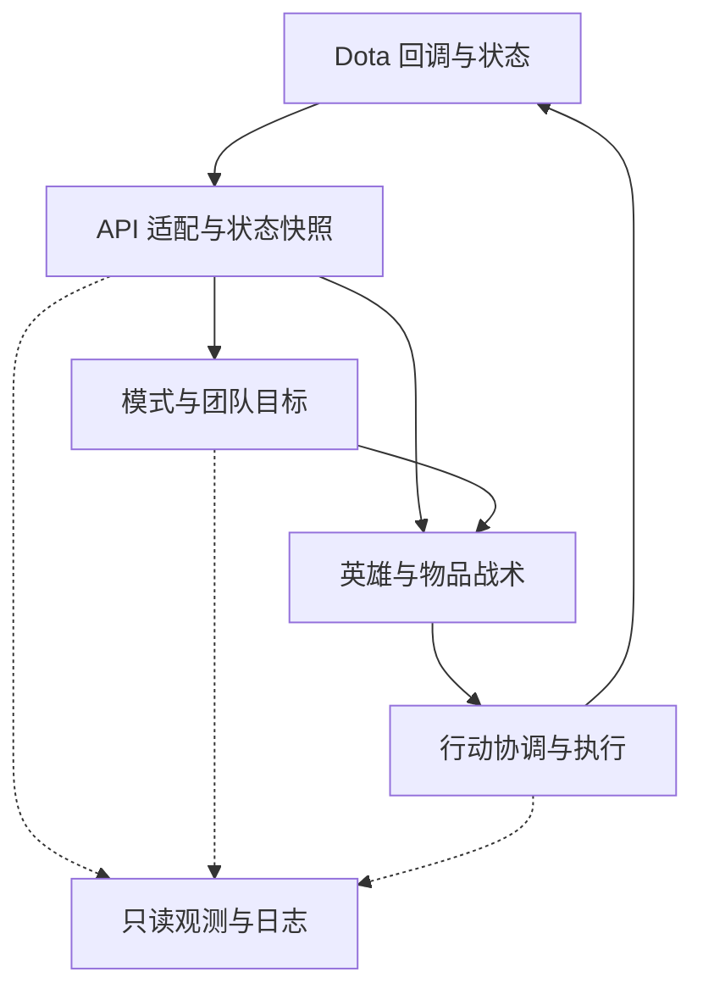

# OHA-Next：目标架构与推进路线

> 状态：设计基线，待分阶段实现；本文件的存在不表示所述模块已经落地。
>
> 更新日期：2026-11-19（北京时间）
>
> 需求入口：[OHA_NEXT_REQUIREMENTS.md](OHA_NEXT_REQUIREMENTS.md)
>
> 现有代码地图：[ARCHITECTURE.md](ARCHITECTURE.md)
>
> 数据协议：[MATCH_DATA_PIPELINE.md](MATCH_DATA_PIPELINE.md)
>
> 分支、外部来源与测试门槛：[UPSTREAM_AND_FORK_WORKFLOW.md](UPSTREAM_AND_FORK_WORKFLOW.md)

## 1. 架构决定

采用 **沿用 OHA 的模块化单体 + 独立自动验证工具链**。游戏内继续使用 Lua 5.1 兼容代码及现有 TypeScript-to-Lua 构建；游戏外负责启动对局、收集数据、回归分析和报告。先建立证据链，再逐步改进动作协调和团队决策。

这一选择兼顾已有英雄覆盖、上游同步成本与低人工测试负担。保留现有 Valve 回调、模式选择和英雄模块，在明确的入口增加适配层；每项改造都能单独验证、关闭或回退。

| 决定 | 采用方式 | 原因 / 约束 |
| --- | --- | --- |
| 游戏运行时 | 手写 Lua + 现有 TSTL；目标 Lua 5.1 | [tsconfig-tstl.json](../tsconfig-tstl.json) 已定义该目标 |
| 构建 | 复用 [package.json](../package.json) 的 `npm run build` 与锁文件 | 保持 TS / 生成 Lua 一致，避免并行维护两份逻辑 |
| 策略表达 | 保留模式欲望与规则评分，局部使用有生命周期的状态机 | 先解决具体冲突，不整体替换成新的行为树或 GOAP |
| 行动协调 | 共用守卫、意图有效期、明确中断规则；逐步集中执行 | 保留合法连招和物品队列，减少互相覆盖的命令 |
| 对局工具 | Python 3 命令行工具，优先标准库；现有 Node 构建照常使用 | 日志处理、进程管理和报告在游戏外独立测试 |
| 数据存储 | 每局独立目录，JSON / JSONL / CSV / Markdown | 初期不用数据库、消息队列或常驻分析服务 |
| 验证执行 | GitHub 托管 CI 跑离线检查；配置 Dota 的独立主机跑真实对局 | 游戏安装和运行条件与普通 CI 分开管理 |
| 数据回传 | 工作流日志 + artifact；压缩包上传作为备用 | 能从仓库关联到证据，也能在未接通自动上传时分析 |

暂不把远程大模型、强化学习训练、微服务或全英雄重写列为当前交付依赖。以后若真实数据证明有必要，通过单独设计与评测引入。

## 2. 当前事实与目标边界

截至本次记录，`oha-next` 仍以 `cb814c6c8dc51ed08045d6efd9f4a48147992711` 为基线。已有模式文件、英雄 `SkillsComplement` / `Consider*`、公共库以及 TS 缓存代码；这些是演进基础，不是新架构已经实现的证据。

[PR #1](https://github.com/littleredcap/dota2bot-OpenHyperAI/pull/1) 中，Lua 5.1 语法检查和 5 个离线回归用例已有[通过记录](https://github.com/littleredcap/dota2bot-OpenHyperAI/actions/runs/44456852894)。PR 仍是 Draft，尚未合入；测试只覆盖目标锁定及 Roshan 估算的局部函数，不等于全模块加载、全部调用路径或真实游戏测试通过。

**尚未具备：** OHA-Next 结构化对局埋点、已配置的 Dota 测试主机、真实数据完整性校验、可靠的同场 A/B 隔离，以及对局结果自动上传并由助手读回的端到端验证。

## 3. 游戏内的逻辑边界

这是目标逻辑划分，不要求一次性搬迁现有文件。

### 3.1 引擎适配与状态快照

- 在窄接口中封装时间、单位有效性、可见性、技能状态、距离和现有缓存读取；离线测试可替换这些接口。
- 快照包含采样时刻、信息来源与新鲜度。复用现有 `global_cache` 的有效部分，先验证其生命周期，避免建立两套互不一致的缓存。
- 正式决策只使用该 bot 合法可观察的数据；最后可见位置应带时间，不能当作当前精确位置。回放或分析侧的全局真值不得回灌到正式决策。
- 不把全部游戏 API 再包装一遍。先覆盖被改动的决策与执行路径，缺少接口时再扩展。

### 3.2 模式与团队目标

复用 `mode_*_generic.lua` 与现有 role / push / defend / farm / roshan 逻辑，逐步输出明确的目标、响应角色、截止时间和放弃条件。初期保留引擎的模式欲望选择，新增协调只作为受控建议。

第一批候选问题包括：目标锁定被绕过、防守响应过多、资源争抢、Roshan 参战成员与估算不符。每次只处理一个可观测问题，不同时换掉全部团队策略。

**不假定模块级 Lua 变量在全部 bot 之间共享。** 团队协调先采用已有团队查询、稳定角色分配和确定性规则；跨 bot 的共享黑板、集中 planner 或跨队构建隔离，必须先验证 VM、模块缓存及状态生命周期。无法验证时，保留本地决策与明确的降级路径。

### 3.3 英雄与物品战术

保留 `bots/BotLib/hero_*.lua` 和现有 `Consider*`。逐步让被改造路径返回意图，再由协调层决定是否执行。未迁移的路径继续遵循原有代码，但必须标记覆盖边界，不能声称所有命令已被统一仲裁。

一个逻辑意图的建议契约：

| 字段组 | 含义 |
| --- | --- |
| `intent_id`, `actor_id`, `producer` | 谁发出、来源模块、可追踪标识 |
| `channel`, `kind`, `target` | 行动通道、动作类型、对象或位置 |
| `priority`, `reason_code`, `preconditions` | 为什么选择、何时合法；评分只在同一契约内比较 |
| `created_at`, `expires_at` | 游戏时间与有效期；不把旧目标永久保留 |
| `interrupt_policy`, `queue_group` | 允许哪些中断，哪些多步动作属于同一执行事务 |
| `state` | proposed / accepted / rejected / submitted / observed / expired / interrupted |

这些名称是待实现接口，不是现有 API。

### 3.4 行动协调与执行

目标是 **同一英雄、同一行动通道内不提交互相冲突的意图**，并保护已开始的引导、前摇和明确的队列。不能用“每帧只能调用一次 Action API”作为通用规则：切鞋后施法、合法连招和独立信使命令可能需要多次调用。

通道按引擎实际互斥的行动资源划分，不能把移动、攻击、技能、物品简单按来源模块各建独立通道，否则互相覆盖仍然存在。具体并发组合需要实机和回归场景确认。

实施规则：

1. 保留现有施法、引导、队列检查，先统一被迁移路径的守卫与原因码。
2. 协调状态必须覆盖相关回调之间的生命周期；只在一个函数里加局部变量，不能解决跨回调抢命令。
3. 每个通道记录当前持有者、意图、到期时间和允许的中断条件；过期、死亡、目标失效与显式取消都需释放。
4. 合法的多步队列作为一个执行事务处理；清空队列必须有具体原因和回归场景。
5. `submitted` 只表示命令已提交；观察到技能进入冷却、资源变化或效果后，才能记录相应的 `observed` 证据。未观测到结果时保留 unknown，不伪造成功。
6. 异常允许受控降级到原逻辑，同时记录错误和降级状态；不能用吞异常让测试显示成功。

### 3.5 观测

游戏内记录启动身份、状态采样、目标/模式变化、意图被选中或拒绝、命令提交、可观察结果与错误。详细字段和失败语义由 [MATCH_DATA_PIPELINE.md](MATCH_DATA_PIPELINE.md) 统一定义。

先记录关键事件与低频状态，不全量逐帧输出。观测应可关闭、限频，溢出时记录丢弃计数。观测逻辑不能改变随机数消费、命令顺序或策略状态；启用前后需要对照验证其开销及行为影响。

## 4. 源码位置与渐进接入

| 位置 | 角色 / 改动规则 |
| --- | --- |
| `bots/mode_*_generic.lua` | 保留现有入口，按场景接入目标或行动守卫 |
| `bots/BotLib/hero_*.lua` | 保留英雄能力与装备逻辑，按覆盖计划迁移意图接口 |
| `bots/ability_item_usage_generic.lua` | 技能 / 物品回调边界，优先识别已有保护与队列语义 |
| `bots/FunLib/jmz_func.lua` | 保持公共接口；新增 TS 调用时同步 `.d.ts` 声明 |
| `typescript/bots/FunLib/oha_next/`（拟新增） | 新的、适合共享与类型检查的纯决策模块源文件 |
| `bots/FunLib/oha_next/`（拟新增） | 对应生成 Lua；确需手写的适配模块单独标注源码归属 |
| `tests/`（PR #1 已有初始文件） | Lua 回归、API mocks、之后的模块加载与调用路径覆盖 |
| `tools/match_runner/`（拟新增） | Python 启动、采集、解析、校验、汇总与打包工具 |
| `tests/fixtures/match_logs/`（拟新增） | 小型去敏日志及异常样本，不提交批量原始对局数据 |
| `schemas/`（拟新增） | 版本化的数据包与事件契约 |

新模块每个文件只有一个源码真源。TS 生成文件从 TS 改并构建；纯 Lua 文件直接改。避免全库格式化、无关重命名和一次性目录迁移，降低同步原作者时的冲突。

接入顺序为：**建立回归 → 增加观测 → 无副作用的影子计算 → 小范围启用 → 扩大覆盖**。影子计算只比较建议，不得发指令或改变旧逻辑的状态。开关关闭时回到明确定义的旧路径，不能同时运行两套执行器。

## 5. 游戏外验证架构

| 部分 | 工作 | 输出 |
| --- | --- | --- |
| 托管 CI | Lua 5.1 语法、受影响的离线回归；涉及 TS 时构建；工具契约检查 | 检查结果与可定位的失败信息 |
| 独立 Dota 主机 | 部署固定构建、验证实际加载、启动/监控对局、超时停止 | 原始日志、启动身份、进程状态 |
| 解析与评估 | 结构化事件 + 版本化引擎日志适配器；校验后计算指标 | 单局数据包、批次报告、完整性状态 |
| 上传与读取 | 发布工作流 artifact 和简短日志摘要；助手在会话中读取 | 可追踪的 run / artifact 链接与分析结论 |

首期先做单机、串行、正常时间倍率的完整闭环。启动参数、headless 能力、脚本加载方式和日志格式均需在所选游戏构建上校准。随后再考虑批跑、并行、加速与云主机；加速数据与正常倍率分开标识。

自动调度的建议部署是独立测试机 + 受控调度环境，可采用私有调度仓库的 self-hosted runner，只接受已审查的完整源码 SHA。公开源仓库的任意 PR 继续在托管 CI 跑 T0/T1；不直接交给含日常资料或 Steam 凭据的常驻主机执行。GitHub 对公共仓库自托管 runner 的[官方说明](https://docs.github.com/en/actions/how-tos/manage-runners/self-hosted-runners/add-runners)给出了这一边界的原因。

这次设计不创建测试机、私有仓库、付费资源或定时任务。运行凭据留在受控主机/调度环境，不进入 Lua、源码、对局日志和提交。

## 6. 实验与发布的证据规则

- T0 / T1 / T2 / T3 的适用条件沿用[维护规范](UPSTREAM_AND_FORK_WORKFLOW.md)。T2 是真实引擎运行，可以自动完成；T3 才是人工体验抽查。
- 文档或独立工具的低风险修改按影响验证，不要求进游戏。局部算法有对应离线断言；涉及回调、动作中断、团队策略的效果结论需要真实数据。
- 首场先证明“运行的是目标版本，数据完整且助手读得到”。A/A 用于检查管道、侧别与环境偏差，不能证明两个版本相等。
- 真正比较候选与基线时，必须确认双方版本隔离、配置、阵容与换边。两个版本分别自博弈的天辉胜率，不能作为候选更强的证据。
- 全部尝试都进入报告，包括超时、崩溃与坏数据；胜率只针对符合预定规则的有效完赛样本，并同时披露排除数与原因。
- 预先指定主要指标、失败阈值、样本计划和停止规则。报告样本量、配对方式与不确定性；不能看到几场优势后临时停止并宣称整体增强。
- `oha-next` 是审核后的开发集成线，**不自动等同于稳定发布**。经所有者审查允许合入的实验功能必须标注未验证范围，行为开关默认关闭；无开关的核心实验改动继续留在 Draft。稳定版本另由发布验收与明确 tag 标识。

## 7. 推进阶段与完成条件

| 阶段 | 具体交付 | 完成条件 | 对应需求 |
| --- | --- | --- | --- |
| M0：设计基线 | 本文、需求清单、数据协议、文档互链 | 事实 / 计划分开，需求有验收与待定项 | U-01～U-05 |
| M1：离线基础与可观测性 | 数据 schema、解析/校验器与异常 fixtures；最小启动/行为埋点；扩充必要调用路径测试 | 缺数据、错误版本、重复/截断等样本被正确识别；Lua 5.1 回归有证据 | D-01～D-05 |
| M2：首场真实闭环 | 一台测试主机、固定 SHA、单局采集、数据包、上传与助手读回 | 至少 1 局身份匹配的真实 completed 对局，可信胜负 / 时长与必需数据有效，助手实际读回；失败包另验异常链路 | U-04；D-03～D-06 |
| M3：小范围行动改造 | 游走锁定或一个技能/物品冲突场景；守卫、开关与原因码 | 合法连招不被破坏；局部回归 + 对应真实场景通过，存在回退路径 | D-02、D-08 |
| M4：可解释的对照 | 校准版本隔离、固定对手/同场 A/B、换边与批次分析 | 双方身份明确；结果有效性、失败率和统计限制完整；再评价行为改善 | D-06、D-07 |
| M5：团队优化与发布 | 按问题引入响应、资源、Roshan 等改进；扩展英雄与模式覆盖 | 对应需求与数据成立，发布前做必要的短时体验抽查 | D-07～D-09 |

M1 中协议、解析器和离线覆盖可在测试机未决定前推进。M2 需要一次环境配置与校准配合；不需要用户每个 PR 操作英雄。若环境暂不可用，继续离线工作并明确阻塞项，不以 mock 成功代替真实验证。

## 8. 外部 Fork 如何进入本架构

外部实现是候选来源。优先研究离线测试、诊断日志与具体可复现的 Bug 修复；动作仲裁、团队策略等必须映射到上述边界后分批接入。每次记录精确来源 SHA、许可证、依赖、改写范围、验收和回退。

`dragonghy/dota2bot` 的批跑、日志解析与 A/B 工具可参考，但其 README 与解析器的校准状态说明不同步，A/B dispatcher 还列有 VM 隔离待验证假设。不能把对方的代码存在，视作我们的环境验证通过。详见[数据链路的参考说明](MATCH_DATA_PIPELINE.md#10-参考与已知差异)。

## 9. 后续仍需决定

测试主机的位置与 OS、游戏安装方式、首个支持模式、首批测试英雄、运行时段、资源预算、保留期及正式发布门槛尚未由用户确认。它们记录在需求文档，到了相应实现阶段再确定；当前不预设 Turbo 优先、固定英雄数量、云费用或胜率提升百分比。
